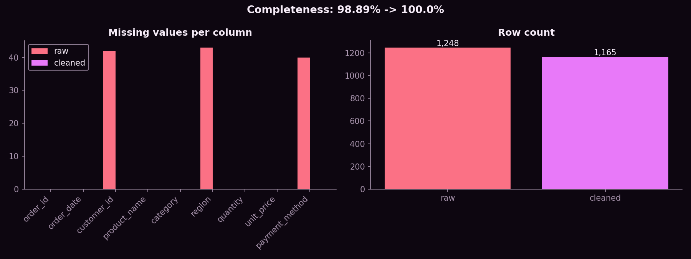

# Data Cleaning Pipeline

   

**Live audit demo:** https://hassan3443.github.io/data-cleaning-pipeline/ (what the run changed, plus an in-browser cleaner)

A reusable Python/Pandas pipeline that turns a messy raw sales CSV into a clean, analysis-ready dataset, and documents every fix it makes in a generated cleaning report.

Raw business data is rarely usable as-is. This project demonstrates a practical cleaning workflow for the issues that show up in real exports: duplicates, mixed date formats, inconsistent category naming, missing values, currency symbols inside numeric fields, and invalid negative quantities.

## What it does

1. Standardizes column names to snake_case
2. Removes exact duplicate rows
3. Trims whitespace and unifies category casing (`electronics `, `ELECTRONICS` -> `Electronics`)
4. Parses mixed date formats (`2025-01-31`, `31/01/2025`, `01-31-2025`, `31 Jan 2025`) into ISO dates. Ambiguous dates follow a stated convention: `a/b/YYYY` is day-first, `a-b-YYYY` is month-first (see below)
5. Coerces `unit_price` to numeric, stripping `$`, `EGP` and thousand separators
6. Fills missing values (median for numerics, `Unknown` for categoricals)
7. Drops rows with non-positive quantity or price
8. Adds a derived `total_amount` column and writes a markdown cleaning report
9. Optional: flags price outliers with the IQR rule per category (`--flag-outliers`), keeping the rows so you decide what is an error and what is a premium product
10. Optional: draws a before/after quality chart (`--plot`)

## Before and after



## Dates: one real ambiguity, handled on purpose

In this file, 301 dates are written like `31/01/2025`, and 124 of them have both numbers 12 or below (for example `03/07/2025`), so they could be 3 July or 7 March. An earlier version of this pipeline tried month-first and only fell back to day-first when that failed, so it silently misread such dates. Reading them month-first would change 110 of the 301 (computed by `src/audit.py`). The pipeline now decides by separator: a slash means day-first, a dash means month-first. If your source uses `m/d/Y`, pass `slash_dayfirst=False` to `parse_dates`. A test round-trips every day of two years through all four formats.

## Audit and live demo

`python src/audit.py` runs the pipeline on the raw file and compares it with the output cell by cell. It writes `docs/data.json`: rows through each step, missing values before and after, date and price formats, every spelling variant that was merged, and before/after rows. The live page reads that file. It also contains a small in-browser port of the price, text and date rules (`docs/clean.js`). A Node test checks it against the Python output for every distinct raw price, category and date in the file.

## Project structure

```
data-cleaning-pipeline/
├── data/
│   ├── raw/messy_sales.csv        # 1,248 messy rows (generated demo data)
│   └── cleaned/clean_sales.csv    # pipeline output
├── reports/cleaning_report.md     # generated before/after stats
├── src/
│   ├── generate_messy_data.py     # creates the messy demo dataset
│   ├── clean_data.py              # the pipeline (CLI)
│   ├── quality.py                 # profiling, IQR outlier flags, before/after chart
│   └── audit.py                   # cell-level audit, writes docs/data.json
├── docs/                          # live demo (static page + clean.js)
├── tests/test_clean_data.py       # pytest suite
├── tests/js/check.test.js         # checks docs/clean.js against the pipeline
├── figures/before_after.png
├── Makefile                       # make clean / make test
└── requirements.txt
```

## Run it

```bash
pip install -r requirements.txt

python src/generate_messy_data.py   # regenerate the messy demo data (optional)
python src/clean_data.py            # clean it
```

Point it at your own file:

```bash
python src/clean_data.py --input your_data.csv --output cleaned.csv --report report.md
python src/clean_data.py --flag-outliers --plot figures/before_after.png   # extras
```

## Sample output

| Metric | Value |
| --- | --- |
| Rows before cleaning | 1,248 |
| Exact duplicates removed | 48 |
| Rows dropped (invalid quantity/price) | 35 |
| Rows after cleaning | 1,165 |
| Completeness after cleaning | 100% |

The full before/after details are in [reports/cleaning_report.md](reports/cleaning_report.md).

## Tests

A pytest suite (60 tests) covers the cleaning rules (duplicates, category normalization, mixed date parsing, price coercion, invalid rows, missing-value filling, derived totals):

```bash
pip install pytest
python -m pytest tests/ -q
node --test tests/js/check.test.js   # browser cleaner matches the pipeline
```

## Tools

Python, Pandas, Matplotlib, pytest

## Note on the data

The included dataset is synthetic, generated by `src/generate_messy_data.py` with a fixed random seed, so results are reproducible. The pipeline itself is dataset-agnostic and works on any sales export with the same columns.

## Author

Hassan Ashraf - [github.com/Hassan3443](https://github.com/Hassan3443)
